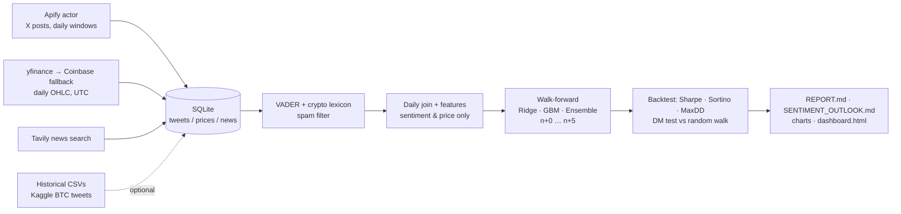

# X Sentiment → BTC Price Prediction

This Python pipeline forecasts **Bitcoin's daily close at n+0 … n+5** using only **X (Twitter) sentiment and price**. It works in five stages:

1. Scrape 180 days of X posts with **Apify** and pull recent news with **Tavily**.
2. Join posts, prices and news in **SQLite**.
3. Build features with no look-ahead.
4. Train per-horizon models under **purged walk-forward validation**.
5. Report Sharpe, Sortino and Max Drawdown, with charts of sentiment against price.

Built for the CrowdWisdomTrading Quantitative Data Scientist assessment.



## Quick start (Windows)

1. Double-click **`setup.bat`**. It creates `.venv`, installs the requirements, copies `.env.example` to `.env` and runs the test suite.
2. Open `.env` and fill in `APIFY_TOKEN` and `TAVILY_API_KEY`.
3. Double-click **`run_all.bat`**. It:
   - checks the keys,
   - scrapes one day as a test,
   - scrapes the full 180 days,
   - fetches news and prices,
   - trains the models and writes everything to `outputs/`.

The same steps from any shell (Windows, macOS, Linux):

```bash
python -m venv .venv && .venv\Scripts\activate      # macOS/Linux: source .venv/bin/activate
pip install -r requirements.txt
copy .env.example .env                              # then add your two keys
python run_pipeline.py check                        # verifies Apify, Tavily and prices
python run_pipeline.py scrape --max-windows 1       # spend ~2 cents to confirm the actor works
python run_pipeline.py all                          # scrape → news → prices → analyse
```

No keys yet? `python run_pipeline.py demo` runs the whole pipeline offline on **synthetic** data and writes to `outputs/demo/`. Every demo file is stamped *DEMO*.

| Command | What it does |
|---|---|
| `check` | Validates the API keys, the actor ID and price access before you spend credits |
| `scrape [--max-windows N]` | Runs the Apify actor once per UTC day (newest first). The job resumes where it stopped: finished days are skipped |
| `news` | Tavily `topic=news` searches; stores articles, the summary answer and a sentiment score for each article |
| `prices` | Daily OHLC bars for `BTC-USD`. Today's unfinished candle is never stored |
| `historical --csv FILE [--start --end --per-day]` | Loads a historical tweet CSV (e.g. the Kaggle BTC sets in the brief) as extra training data |
| `analyse` | Sentiment scoring → features → walk-forward → backtest → charts → reports |
| `all` | `scrape` + `news` + `prices` + `analyse` |
| `demo` | Offline end-to-end run on synthetic data |

## What gets produced (`outputs/`)

| File | Contents |
|---|---|
| `REPORT.md` (+ `.pdf` if the optional PDF dependencies are installed) | Evaluation report: data, method, Sharpe / Sortino / Max DD, accuracy by horizon, significance tests, limitations |
| `SENTIMENT_OUTLOOK.md` | One-page current sentiment outlook: verdict, key numbers, model path with an 80% band, most-engaged posts, news backdrop |
| `dashboard.html` | Interactive offline chart of sentiment against price, with hover tooltips, 30/90/180-day ranges and the forecast band |
| `charts/*.png` | Sentiment vs price over time; sentiment→return correlation matrix (feature × horizon) plus lead/lag bars; rolling correlation; forecast vs actual for every horizon; equity curve and drawdown; skill by horizon |
| `oos_predictions.csv` | Every out-of-sample prediction (date, horizon, model, forecast vs actual) |
| `forecast_metrics.csv`, `backtest_metrics.csv`, `live_forecast.csv`, `metrics.json` | Machine-readable results |
| `ADDENDUM_VARIANTS.md` / `.pdf`, `RUN_COMPARISON.md` | Variants (2021–23 history, CryptoBERT) vs Apify only, on the same test days |
| `runs/apify_only/`, `runs/hist_2021_23/`, `runs/cryptobert/` | Saved results of each run (each variant has its own full report and charts) |
| `data/xsent.db` | SQLite with tables `tweets`, `prices`, `news`, `scrape_runs` (actor run IDs, inputs), `daily` (the join), `features`, `predictions` |

## Design decisions

**Timing (no look-ahead).** Row *n* is the current UTC day, and the forecast is made at its 00:00 UTC open.

- *Inputs:* posts and prices up to the close of day *n−1* only. Every feature is shifted by one day.
- *Targets:* `y_h = log(close[n+h] / close[n−1])`. So *n+0* is a real forecast of **today's** close, and *n+5* is the close five days later.
- *Alignment:* BTC trades 24/7 and the daily bar runs 00:00–24:00 UTC, so posts are bucketed by UTC date. An America/New_York timestamp is stored alongside for reference.
- *Testing:* `tests/test_leakage.py` changes every value from day *n* onward and checks that row *n*'s features do not change.

**Purged walk-forward.** The training window expands over time. For horizon *h*, a training row *i* is used only if its target was already known when the forecast was made (*i + h ≤ n − 1*). Without this purge, overlapping 5-day targets would leak the test period into training; a test asserts the purge. Ridge's regularisation strength is also chosen by time-ordered cross-validation with a gap of *h*.

**Inputs are sentiment and price only, as the brief requires.**

- *Sentiment:* engagement- and follower-weighted scores, influencer tone, bull−bear share, dispersion, momentum, and z-scores of attention.
- *Price:* lagged returns, momentum, realised volatility, RSI and range.
- *Excluded:* traded volume, on-chain data and macro data.

**Models.**

- *Ridge* and *depth-2 gradient boosting*, plus their *ensemble*. The ensemble was fixed in advance as the primary model, so no model is picked by peeking at test results.
- *Baselines:* a price-only Ridge (the ablation that answers "does X sentiment add anything?"), random walk and drift.
- *Tuning:* hyper-parameters were tuned only on synthetic data, never on the real test window.

**Honest evaluation.**

- *Forecast skill:* RMSE against the random walk, a Diebold–Mariano test, directional accuracy with a binomial p-value, and the information coefficient (IC).
- *Trading:* a long/flat rule with 10 bp costs on each position change, compared with buy and hold over the same days.

**Self-checks of the method** (`tests/test_end_to_end.py`):

- When a sentiment→return signal is planted in synthetic data, the model finds it.
- On pure noise, it does **not** beat the random walk.

The second check is the strongest evidence that the pipeline has no leakage.

## Apify actors and cost

| Actor | ID | Price / 1k tweets | Notes |
|---|---|---|---|
| **kaitoeasyapi/twitter-x-data-tweet-scraper-pay-per-result-cheapest** (default) | set in `.env` | ~$0.25 | `twitterContent` query with `since_time`/`until_time` |
| apidojo/tweet-scraper | `61RPP7dywgiy0JPD0` | ~$0.40 | Free plan cannot call it through the API |
| altimis/scweet | `EvFXOhwR6wsOWmdSK` | ~$0.30 | 3,000-tweet free trial |

The default is 180 daily windows × 80 posts ≈ **14,400 posts ≈ $3.60**, inside Apify's $5/month free credit. Each run is capped by `APIFY_MAX_CHARGE_USD`.

To switch actors, change `APIFY_ACTOR_ID`. Any other actor works through `APIFY_INPUT_TEMPLATE`, a JSON template with these placeholders: `{query} {since} {until} {since_iso} {until_iso} {since_ts} {until_ts} {max_items} {lang} {query_type}`.

## Historical training data (Kaggle)

The brief lists historical tweet datasets for training. **Check the dates before using one.** The Kaggle "Bitcoin Tweets
Dataset (2025–2026)" (`pokeash`) turned out to be the 2021–23 `kaushiksuresh147/bitcoin-tweets` set with shifted timestamps,
so it was not used. `scripts/validate_tweet_dates.py` runs the checks (newest account date, years mentioned in the text,
weekday words against the stamped date).

The genuine 2021–23 set was loaded into a **separate** database, so the primary Apify-only run stays untouched:

```bat
mkdir data\hist_2021_23 && copy data\xsent.db data\hist_2021_23\xsent.db
set DATA_DIR=data/hist_2021_23
set OUT_DIR=outputs/runs/hist_2021_23
python run_pipeline.py historical --csv path\to\Bitcoin_tweets.csv --end 2026-05-08
python run_pipeline.py analyse
```

`scripts/compare_runs.py` then compares runs on the out-of-sample days they share. The results are in
`outputs/ADDENDUM_VARIANTS.md`.

## Tests

```bash
python -m pytest -q
```

There are 26 tests, all with mocked HTTP and no network:

- no look-ahead and purge correctness,
- metric formulas (Sharpe, Sortino, Max DD, Diebold–Mariano, costs),
- timestamp parsing and UTC/EST bucketing,
- Apify windowing and resume, mock-item filtering, Tavily and Coinbase parsing,
- historical CSV formats,
- recovery of a planted signal and no false skill on noise,
- the full demo pipeline.

## Project layout

```
run_pipeline.py          CLI
xsent/config.py          settings (.env)
xsent/db.py              SQLite schema + helpers
xsent/ingest/            apify_x.py · tavily_news.py · prices.py · historical.py · demo.py
xsent/sentiment.py       VADER + crypto lexicon, spam filter (optional FinBERT)
xsent/features.py        daily join, leakage-safe features & targets
xsent/model.py           models, purged walk-forward, live forecast
xsent/backtest.py        Sharpe / Sortino / MaxDD / Calmar, DM test, strategy
xsent/charts.py          matplotlib charts
xsent/dashboard.py       interactive HTML
xsent/outlook.py         1-page sentiment outlook
xsent/report.py          evaluation report (+ optional PDF)
scripts/                 validate_tweet_dates.py · compare_runs.py
tests/                   pytest suite
```
