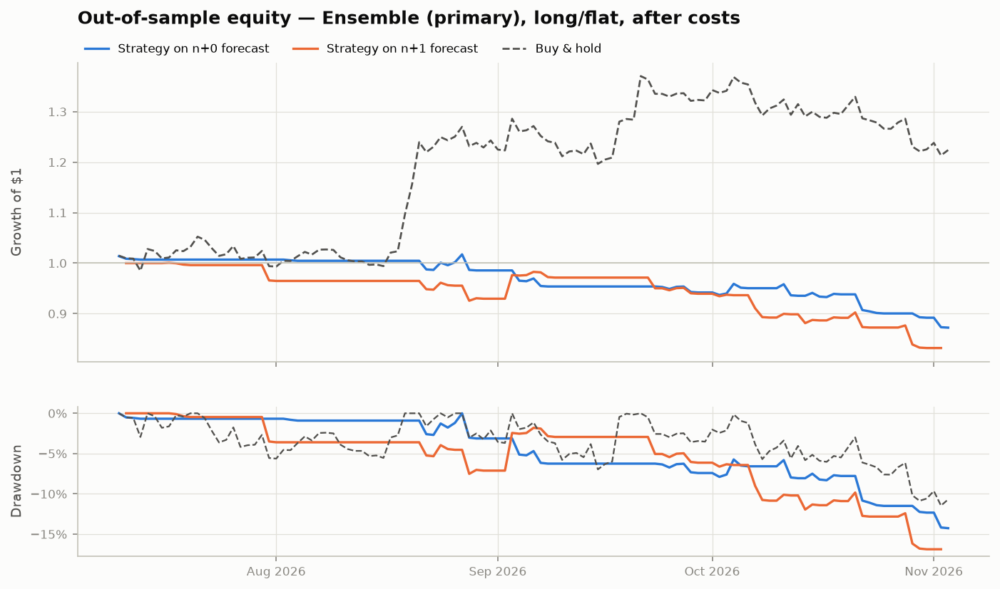
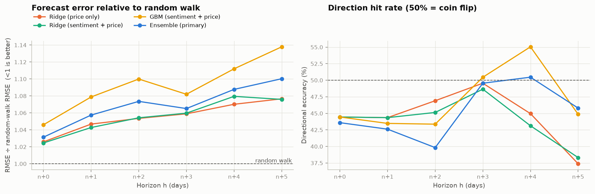
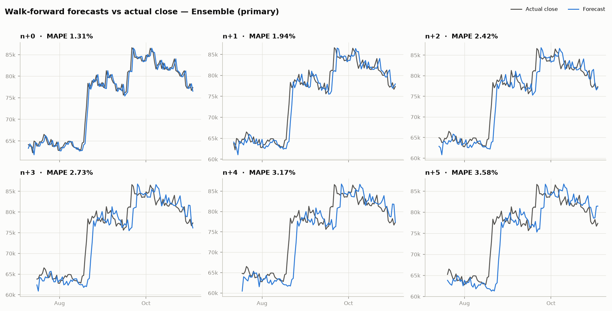
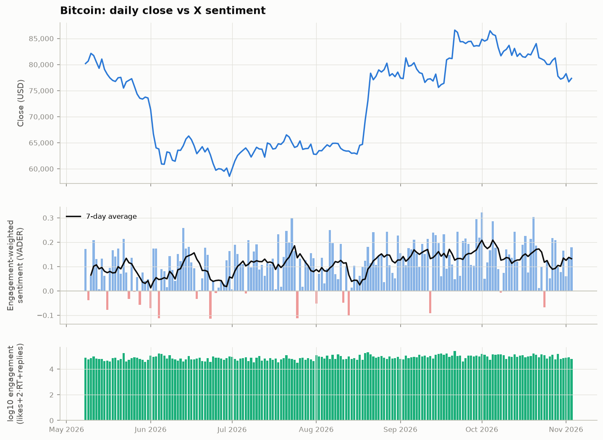
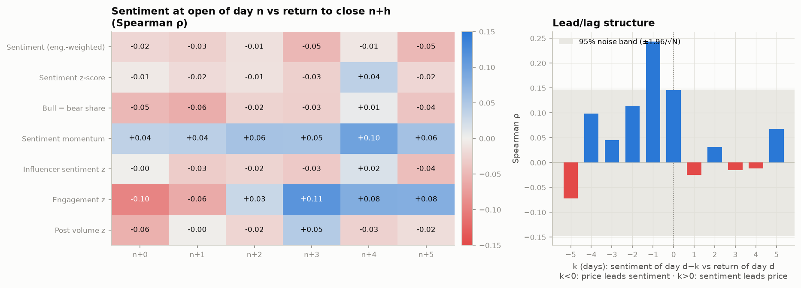
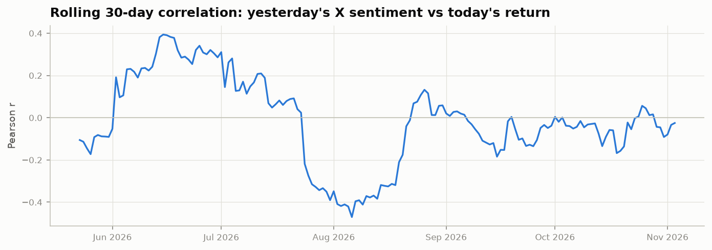

# Bitcoin X-Sentiment Price Prediction — Evaluation Report

Out-of-sample evaluation window: **2026-07-10 → 2026-11-03** (UTC daily bars). Primary model chosen before testing: **Ensemble (primary)**. Transaction cost 10 bp per unit of turnover; risk-free rate 0; annualisation √365.

## 1. Headline results

- **Trading the n+0 forecast (long/flat):** Sharpe **-3.16**, Sortino **-3.57**, Max drawdown **-14.3%**, total return -12.8% with 27.4% time in market.
- **Buy & hold over the same days:** Sharpe 1.88, Sortino 3.47, Max drawdown -11.5%, total return +22.4%.
- **Forecast skill vs random walk:** RMSE ratio ranges 1.031–1.100 across n+0…n+5 (<1 beats the random walk); directional accuracy 39.8%–50.5%.
- **Statistical significance:** the Diebold–Mariano test rejects 'no better than random walk' at 5% for 0 of 6 horizons; it finds the model significantly *worse* than the random walk at 3 (n+0, n+1, n+2).
- **Does X sentiment add information?** Adding sentiment features to the same Ridge model lowered out-of-sample error at 3 of 6 horizons (ablation vs price-only).

## 2. Data

| Source | Posts | Flagged spam | Days | First | Last |
|---|---|---|---|---|---|
| `apify:kaitoeasyapi/twitter-x-data-tweet-scraper-pay-per-result-cheapest` | 9,842 | 344 | 181 | 2026-05-08 | 2026-11-04 |

Prices: 240 daily bars (2026-03-09 → 2026-11-03), source `yfinance`, ticker `BTC-USD`. News: 44 Tavily articles.

Apify runs:

- actor `kaitoeasyapi/twitter-x-data-tweet-scraper-pay-per-result-cheapest` — SUCCEEDED: 180 windows, 9,842 posts

X query: `(bitcoin OR BTC OR $BTC OR #bitcoin OR #BTC)` (ticker, cashtag and keyword in one advanced search), language `en`, 24-hour windows capped at 80 posts, sort `Top`. Posts are bucketed by UTC date to match the 00:00–24:00 UTC daily bar; an America/New_York timestamp is stored alongside for reference.

## 3. Method

**Timing (no look-ahead).** Row *n* is the current day; the forecast is made at its 00:00 UTC open using posts and prices up to the close of day *n−1* only. Targets are `log(close[n+h] / close[n−1])` for h = 0…5, so *n+0* is today's close and *n+5* the close five days later. Forecast prices are `close[n−1] · exp(ŷ)`.

**Sentiment.** VADER (built for social-media text) extended with a crypto lexicon (moon, rekt, HODL, FUD, dump, ETF inflows/outflows, …). URLs and @mentions are stripped; cashtag-stuffed shill posts (> 5 cashtags), same-day duplicates and near-empty posts, and giveaway / engagement-farming posts ("repost & reply with your BTC address") are flagged as spam and excluded.

**Features — sentiment (13):** engagement-weighted score and its rolling 30-day z-score, follower-weighted and influencer (≥10k followers) z-scores, bull−bear share, dispersion, 1-day change, 3/7-day EMA momentum, 7-day mean, post-volume and engagement z-scores, sentiment×engagement. **Price (13):** 1/2/3-day lagged returns, 5/10/20-day momentum, 7/20-day realised volatility, RSI-14, gap to the 20-day mean, high-low range, day-of-week. No traded volume, on-chain or macro inputs.

**Models.** One model per horizon: Ridge (regularisation chosen by time-ordered CV with a gap of h days) and depth-2 gradient-boosted trees on sentiment + price, their average (the *ensemble*, fixed in advance as primary), a price-only Ridge as an ablation, and random-walk / drift baselines.

**Walk-forward validation.** Expanding window, minimum 60 training days, refit every 1 day(s). For horizon *h*, training rows are purged so every training target is already realised at the forecast time (row *i* is used only if *i + h ≤ n − 1*). Every prediction in this report is out of sample.

**Backtest.** At each open, go long if the forecast log-return > 0, otherwise flat; hold one day; pay costs on every change of position. Each horizon's forecast is traded as its own signal so positions never overlap.

## 4. Trading performance (out of sample, after costs)

| Signal | Sharpe | Sortino | Max DD | Total return | CAGR | Ann. vol | Calmar | Exposure | Hit rate | Trades |
|---|---|---|---|---|---|---|---|---|---|---|
| Buy & hold | 1.88 | 3.47 | -11.5% | +22.4% | +87.8% | 37.2% | 7.66 | 100.0% | 49.6% | 1 |
| Ensemble (primary) · n+0 | -3.16 | -3.57 | -14.3% | -12.8% | -34.7% | 13.2% | -2.43 | 27.4% | 37.5% | 28 |
| Ridge (price only) · n+0 | -1.62 | -2.41 | -12.0% | -9.2% | -25.9% | 17.6% | -2.16 | 24.8% | 37.9% | 16 |
| Ensemble (primary) · n+1 | -3.12 | -3.70 | -16.9% | -16.8% | -44.3% | 18.2% | -2.62 | 27.0% | 45.2% | 34 |
| Ridge (price only) · n+1 | -1.93 | -2.26 | -7.7% | -7.7% | -22.3% | 12.7% | -2.92 | 23.5% | 44.4% | 4 |
| Ensemble (primary) · n+2 | -1.94 | -2.46 | -13.8% | -10.3% | -29.7% | 17.4% | -2.16 | 25.7% | 44.8% | 32 |
| Ridge (price only) · n+2 | -1.97 | -2.30 | -7.3% | -7.3% | -21.8% | 12.1% | -2.97 | 22.1% | 40.0% | 10 |
| Ensemble (primary) · n+3 | -1.89 | -2.18 | -9.3% | -7.7% | -23.2% | 13.5% | -2.48 | 25.2% | 46.4% | 20 |
| Ridge (price only) · n+3 | -1.92 | -2.28 | -7.8% | -7.8% | -23.4% | 13.4% | -3.01 | 30.6% | 41.2% | 2 |
| Ensemble (primary) · n+4 | -2.29 | -2.60 | -10.8% | -9.0% | -27.2% | 13.5% | -2.51 | 24.8% | 44.4% | 14 |
| Ridge (price only) · n+4 | -1.94 | -2.31 | -7.8% | -7.8% | -23.8% | 13.5% | -3.05 | 32.1% | 40.0% | 2 |
| Ensemble (primary) · n+5 | -0.34 | -0.53 | -8.9% | -2.3% | -7.6% | 18.3% | -0.86 | 26.2% | 46.4% | 19 |
| Ridge (price only) · n+5 | -2.14 | -2.44 | -10.1% | -9.8% | -29.8% | 15.9% | -2.96 | 34.6% | 43.2% | 1 |



## 5. Forecast accuracy by horizon

| Horizon | Model | N | MAPE % | RMSE $ | RMSE ÷ RW | Dir. acc. | p (dir) | IC | DM stat | DM p |
|---|---|---|---|---|---|---|---|---|---|---|
| n+0 | Ensemble (primary) | 117 | 1.31 | $1,490 | 1.03 | 43.6% | 0.93 | -0.18 | 2.35 | 0.02 |
| n+0 | GBM (sentiment + price) | 117 | 1.35 | $1,513 | 1.05 | 44.4% | 0.90 | -0.09 | 2.63 | 0.01 |
| n+0 | Ridge (sentiment + price) | 117 | 1.30 | $1,477 | 1.02 | 44.4% | 0.90 | -0.17 | 1.82 | 0.07 |
| n+0 | Ridge (price only) | 117 | 1.30 | $1,479 | 1.03 | 44.4% | 0.90 | -0.14 | 1.82 | 0.07 |
| n+0 | Random walk | 117 | 1.26 | $1,450 | 1.00 | – | – | – | – | – |
| n+1 | Ensemble (primary) | 115 | 1.94 | $2,162 | 1.06 | 42.6% | 0.95 | -0.16 | 2.44 | 0.01 |
| n+1 | GBM (sentiment + price) | 115 | 1.98 | $2,206 | 1.08 | 43.5% | 0.93 | -0.15 | 2.71 | 0.01 |
| n+1 | Ridge (sentiment + price) | 115 | 1.92 | $2,132 | 1.04 | 44.3% | 0.90 | -0.17 | 2.17 | 0.03 |
| n+1 | Ridge (price only) | 115 | 1.94 | $2,139 | 1.05 | 44.3% | 0.90 | -0.18 | 2.13 | 0.03 |
| n+1 | Random walk | 115 | 1.86 | $2,061 | 1.00 | – | – | – | – | – |
| n+2 | Ensemble (primary) | 113 | 2.42 | $2,757 | 1.07 | 39.8% | 0.99 | -0.25 | 2.33 | 0.02 |
| n+2 | GBM (sentiment + price) | 113 | 2.50 | $2,824 | 1.10 | 43.4% | 0.93 | -0.23 | 2.59 | 0.01 |
| n+2 | Ridge (sentiment + price) | 113 | 2.38 | $2,707 | 1.05 | 45.1% | 0.87 | -0.27 | 2.17 | 0.03 |
| n+2 | Ridge (price only) | 113 | 2.36 | $2,705 | 1.05 | 46.9% | 0.77 | -0.24 | 2.12 | 0.03 |
| n+2 | Random walk | 113 | 2.27 | $2,590 | 1.00 | – | – | – | – | – |
| n+3 | Ensemble (primary) | 111 | 2.73 | $3,295 | 1.07 | 49.5% | 0.58 | -0.12 | 1.72 | 0.09 |
| n+3 | GBM (sentiment + price) | 111 | 2.77 | $3,342 | 1.08 | 50.5% | 0.50 | -0.03 | 1.83 | 0.07 |
| n+3 | Ridge (sentiment + price) | 111 | 2.75 | $3,282 | 1.06 | 48.6% | 0.65 | -0.28 | 1.87 | 0.06 |
| n+3 | Ridge (price only) | 111 | 2.73 | $3,280 | 1.06 | 49.5% | 0.58 | -0.27 | 1.84 | 0.07 |
| n+3 | Random walk | 111 | 2.63 | $3,125 | 1.00 | – | – | – | – | – |
| n+4 | Ensemble (primary) | 109 | 3.17 | $3,892 | 1.09 | 50.5% | 0.50 | -0.13 | 1.66 | 0.10 |
| n+4 | GBM (sentiment + price) | 109 | 3.24 | $3,969 | 1.11 | 55.0% | 0.17 | -0.03 | 1.66 | 0.10 |
| n+4 | Ridge (sentiment + price) | 109 | 3.26 | $3,867 | 1.08 | 43.1% | 0.94 | -0.30 | 2.04 | 0.04 |
| n+4 | Ridge (price only) | 109 | 3.18 | $3,841 | 1.07 | 45.0% | 0.87 | -0.28 | 1.78 | 0.08 |
| n+4 | Random walk | 109 | 3.03 | $3,626 | 1.00 | – | – | – | – | – |
| n+5 | Ensemble (primary) | 107 | 3.58 | $4,405 | 1.10 | 45.8% | 0.83 | -0.16 | 1.42 | 0.16 |
| n+5 | GBM (sentiment + price) | 107 | 3.70 | $4,530 | 1.14 | 44.9% | 0.88 | -0.08 | 1.45 | 0.15 |
| n+5 | Ridge (sentiment + price) | 107 | 3.64 | $4,326 | 1.08 | 38.3% | 0.99 | -0.25 | 1.64 | 0.10 |
| n+5 | Ridge (price only) | 107 | 3.65 | $4,328 | 1.08 | 37.4% | 1.00 | -0.27 | 1.67 | 0.10 |
| n+5 | Random walk | 107 | 3.40 | $4,063 | 1.00 | – | – | – | – | – |

*RMSE ÷ RW < 1 means lower error than the random walk. DM = Diebold–Mariano test on squared errors vs random walk (Newey–West, lag h); negative = model better. p (dir) = one-sided binomial test of the hit rate against 50%.*





## 6. Sentiment vs price







## 7. Live forecast (from the latest close)

| Horizon | Date | Forecast | 80% low | 80% high | Random walk |
|---|---|---|---|---|---|
| n+0 | 2026-11-04 | $77,215 | $75,293 | $79,186 | $77,345 |
| n+1 | 2026-11-05 | $77,186 | $74,406 | $80,070 | $77,345 |
| n+2 | 2026-11-06 | $77,360 | $73,828 | $81,060 | $77,345 |
| n+3 | 2026-11-07 | $77,192 | $73,001 | $81,623 | $77,345 |
| n+4 | 2026-11-08 | $77,134 | $72,196 | $82,410 | $77,345 |
| n+5 | 2026-11-09 | $76,930 | $71,382 | $82,908 | $77,345 |

## 8. Limitations

- Only 117 out-of-sample trading days: an annualised Sharpe ratio estimated on that sample has a standard error of roughly ±1.8 (≈√(365/N)), so a Sharpe ratio within about ±3.5 of zero (or of buy & hold) is not statistically distinguishable from it.
- Each day's sentiment is a capped sample of posts (top or latest), not the full X firehose; post-count features therefore measure sampling more than true volume.
- Lexicon sentiment misses sarcasm and context; FinBERT and CryptoBERT are available via `SENTIMENT_ENGINE=finbert` or `cryptobert` for comparison.
- Results depend on one asset and one period; no hyper-parameters were tuned on the test window.

**Variants:** a run trained with extra 2021–23 Kaggle tweets, the check that ruled out the re-dated "2025–2026" Kaggle set, and a CryptoBERT sentiment run, each compared on the same test days, are in `ADDENDUM_VARIANTS.md` / `.pdf`.

## 9. Reproduce

```bash
pip install -r requirements.txt
cp .env.example .env   # add APIFY_TOKEN and TAVILY_API_KEY
python run_pipeline.py all
```
