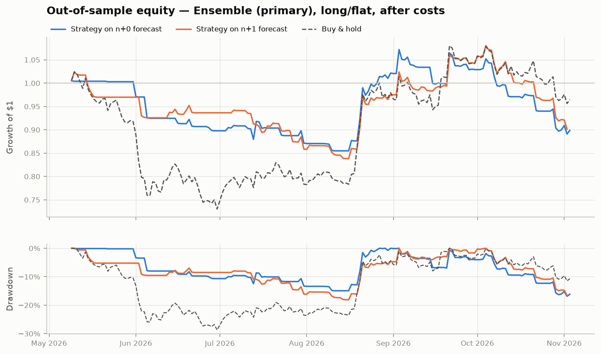
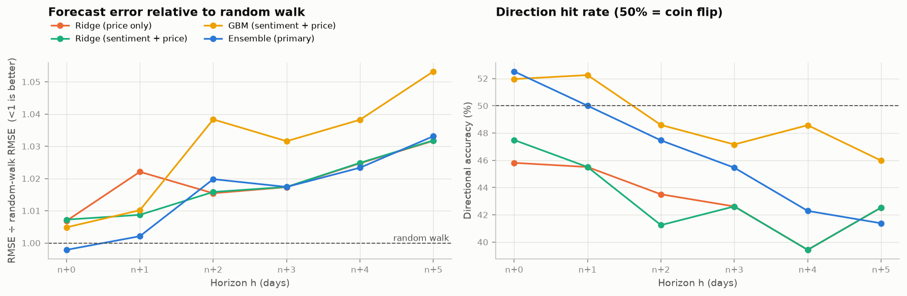
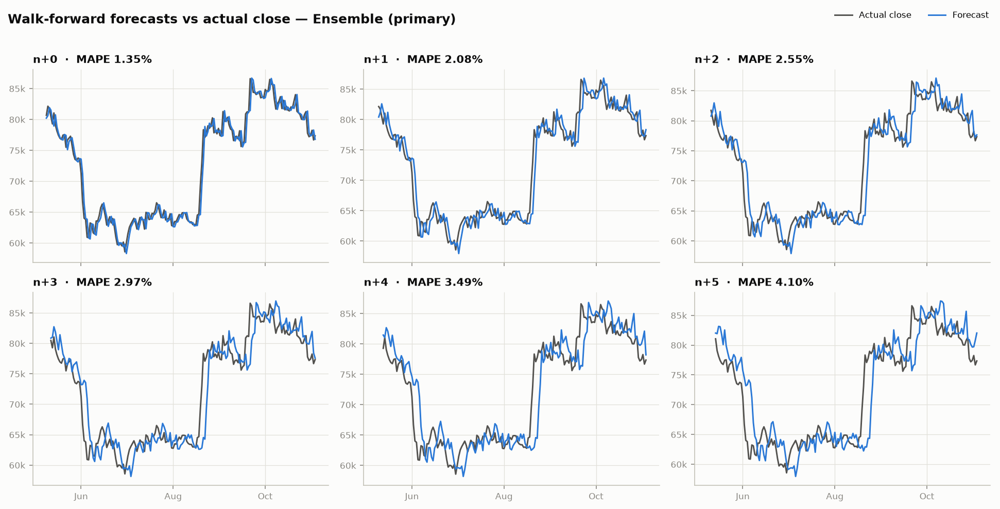
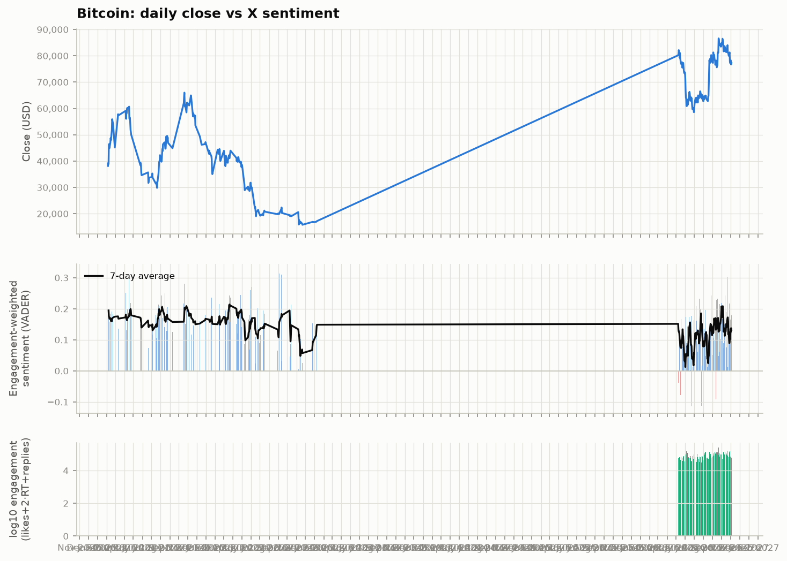
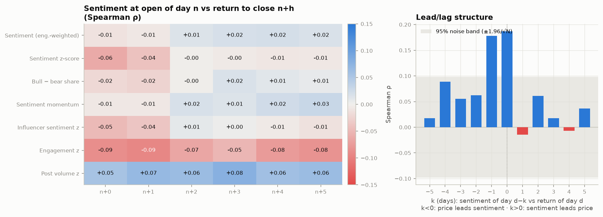
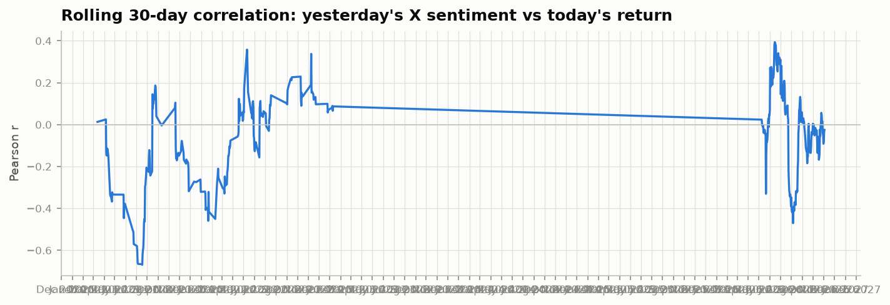

# Bitcoin X-Sentiment Price Prediction — Evaluation Report

Out-of-sample evaluation window: **2026-05-09 → 2026-11-03** (UTC daily bars). Primary model chosen before testing: **Ensemble (primary)**. Transaction cost 10 bp per unit of turnover; risk-free rate 0; annualisation √365.

## 1. Headline results

- **Trading the n+0 forecast (long/flat):** Sharpe **-0.70**, Sortino **-1.10**, Max drawdown **-16.9%**, total return -10.1% with 37.4% time in market.
- **Buy & hold over the same days:** Sharpe -0.01, Sortino -0.02, Max drawdown -28.7%, total return -3.5%.
- **Forecast skill vs random walk:** RMSE ratio ranges 0.998–1.033 across n+0…n+5 (<1 beats the random walk); directional accuracy 41.4%–52.5%.
- **Statistical significance:** the Diebold–Mariano test rejects 'no better than random walk' at 5% for 0 of 6 horizons; it finds the model significantly *worse* than the random walk at 2 (n+4, n+5).
- **Does X sentiment add information?** Adding sentiment features to the same Ridge model lowered out-of-sample error at 1 of 6 horizons (ablation vs price-only).

## 2. Data

| Source | Posts | Flagged spam | Days | First | Last |
|---|---|---|---|---|---|
| `apify:kaitoeasyapi/twitter-x-data-tweet-scraper-pay-per-result-cheapest` | 9,842 | 344 | 181 | 2026-05-08 | 2026-11-04 |
| `hist:Bitcoin_tweets.csv` | 66,300 | 13,148 | 222 | 2021-02-05 | 2023-01-09 |

Prices: 2,158 daily bars (2020-12-07 → 2026-11-03), source `yfinance`, ticker `BTC-USD`. News: 44 Tavily articles.

Apify runs:

- actor `kaitoeasyapi/twitter-x-data-tweet-scraper-pay-per-result-cheapest` — SUCCEEDED: 180 windows, 9,842 posts

X query: `(bitcoin OR BTC OR $BTC OR #bitcoin OR #BTC)` (ticker, cashtag and keyword in one advanced search), language `en`, 24-hour windows capped at 80 posts, sort `Top`. Posts are bucketed by UTC date to match the 00:00–24:00 UTC daily bar; an America/New_York timestamp is stored alongside for reference.

## 3. Method

**Timing (no look-ahead).** Row *n* is the current day; the forecast is made at its 00:00 UTC open using posts and prices up to the close of day *n−1* only. Targets are `log(close[n+h] / close[n−1])` for h = 0…5, so *n+0* is today's close and *n+5* the close five days later. Forecast prices are `close[n−1] · exp(ŷ)`.

**Sentiment.** VADER (built for social-media text) extended with a crypto lexicon (moon, rekt, HODL, FUD, dump, ETF inflows/outflows, …). URLs and @mentions are stripped; cashtag-stuffed shill posts (> 5 cashtags), same-day duplicates and near-empty posts, and giveaway / engagement-farming posts ("repost & reply with your BTC address") are flagged as spam and excluded.

**Features — sentiment (13):** engagement-weighted score and its rolling 30-day z-score, follower-weighted and influencer (≥10k followers) z-scores, bull−bear share, dispersion, 1-day change, 3/7-day EMA momentum, 7-day mean, post-volume and engagement z-scores, sentiment×engagement. **Price (13):** 1/2/3-day lagged returns, 5/10/20-day momentum, 7/20-day realised volatility, RSI-14, gap to the 20-day mean, high-low range, day-of-week. No traded volume, on-chain or macro inputs.

**Models.** One model per horizon: Ridge (regularisation chosen by time-ordered CV with a gap of h days) and depth-2 gradient-boosted trees on sentiment + price, their average (the *ensemble*, fixed in advance as primary), a price-only Ridge as an ablation, and random-walk / drift baselines.

**Walk-forward validation.** Expanding window, minimum 60 training days, refit every 1 day(s). For horizon *h*, training rows are purged so every training target is already realised at the forecast time (row *i* is used only if *i + h ≤ n − 1*). Every prediction in this report is out of sample.

**Backtest.** At each open, go long if the forecast log-return > 0, otherwise flat; hold one day; pay costs on every change of position. Each horizon's forecast is traded as its own signal so positions never overlap.

## 4. Trading performance (out of sample, after costs)

| Signal | Sharpe | Sortino | Max DD | Total return | CAGR | Ann. vol | Calmar | Exposure | Hit rate | Trades |
|---|---|---|---|---|---|---|---|---|---|---|
| Buy & hold | -0.01 | -0.02 | -28.7% | -3.5% | -7.1% | 37.2% | -0.25 | 100.0% | 46.9% | 1 |
| Ensemble (primary) · n+0 | -0.70 | -1.10 | -16.9% | -10.1% | -19.6% | 26.1% | -1.16 | 37.4% | 47.8% | 65 |
| Ridge (price only) · n+0 | -1.66 | -2.29 | -24.5% | -21.8% | -39.4% | 27.8% | -1.61 | 66.5% | 42.9% | 30 |
| Ensemble (primary) · n+1 | -0.71 | -1.11 | -18.1% | -9.8% | -19.1% | 25.5% | -1.06 | 48.3% | 46.5% | 73 |
| Ridge (price only) · n+1 | -0.49 | -0.72 | -25.9% | -10.0% | -19.4% | 32.9% | -0.75 | 82.0% | 45.2% | 25 |
| Ensemble (primary) · n+2 | -0.55 | -0.82 | -17.4% | -8.4% | -16.6% | 26.8% | -0.96 | 48.6% | 47.7% | 49 |
| Ridge (price only) · n+2 | -1.11 | -1.57 | -29.6% | -19.3% | -35.7% | 34.5% | -1.21 | 96.6% | 45.0% | 7 |
| Ensemble (primary) · n+3 | 0.19 | 0.32 | -12.0% | +0.7% | +1.4% | 28.0% | 0.12 | 56.2% | 47.5% | 51 |
| Ridge (price only) · n+3 | -0.01 | -0.02 | -28.7% | -3.5% | -7.2% | 37.4% | -0.25 | 100.0% | 46.6% | 1 |
| Ensemble (primary) · n+4 | -1.10 | -1.68 | -24.0% | -15.3% | -29.2% | 28.0% | -1.22 | 58.3% | 42.2% | 55 |
| Ridge (price only) · n+4 | -0.03 | -0.05 | -28.7% | -3.8% | -7.8% | 37.5% | -0.27 | 100.0% | 46.3% | 1 |
| Ensemble (primary) · n+5 | -0.99 | -1.49 | -28.1% | -15.4% | -29.5% | 30.6% | -1.05 | 65.5% | 46.5% | 49 |
| Ridge (price only) · n+5 | 0.01 | 0.01 | -28.7% | -3.1% | -6.4% | 37.6% | -0.22 | 100.0% | 46.6% | 1 |



## 5. Forecast accuracy by horizon

| Horizon | Model | N | MAPE % | RMSE $ | RMSE ÷ RW | Dir. acc. | p (dir) | IC | DM stat | DM p |
|---|---|---|---|---|---|---|---|---|---|---|
| n+0 | Ensemble (primary) | 179 | 1.35 | $1,399 | 1.00 | 52.5% | 0.27 | 0.04 | -0.22 | 0.83 |
| n+0 | GBM (sentiment + price) | 179 | 1.38 | $1,407 | 1.00 | 52.0% | 0.33 | 0.08 | 0.26 | 0.80 |
| n+0 | Ridge (sentiment + price) | 179 | 1.37 | $1,413 | 1.01 | 47.5% | 0.77 | -0.17 | 2.36 | 0.02 |
| n+0 | Ridge (price only) | 179 | 1.37 | $1,413 | 1.01 | 45.8% | 0.88 | -0.08 | 1.36 | 0.17 |
| n+0 | Random walk | 179 | 1.35 | $1,404 | 1.00 | – | – | – | – | – |
| n+1 | Ensemble (primary) | 178 | 2.08 | $2,072 | 1.00 | 50.0% | 0.53 | 0.02 | 0.22 | 0.83 |
| n+1 | GBM (sentiment + price) | 178 | 2.09 | $2,078 | 1.01 | 52.2% | 0.30 | 0.06 | 0.49 | 0.62 |
| n+1 | Ridge (sentiment + price) | 178 | 2.09 | $2,095 | 1.01 | 45.5% | 0.90 | -0.27 | 1.71 | 0.09 |
| n+1 | Ridge (price only) | 178 | 2.10 | $2,117 | 1.02 | 45.5% | 0.90 | -0.08 | 2.23 | 0.03 |
| n+1 | Random walk | 178 | 2.06 | $2,074 | 1.00 | – | – | – | – | – |
| n+2 | Ensemble (primary) | 177 | 2.55 | $2,654 | 1.02 | 47.5% | 0.77 | -0.05 | 1.47 | 0.14 |
| n+2 | GBM (sentiment + price) | 177 | 2.61 | $2,695 | 1.04 | 48.6% | 0.67 | -0.02 | 1.46 | 0.14 |
| n+2 | Ridge (sentiment + price) | 177 | 2.56 | $2,650 | 1.02 | 41.2% | 0.99 | -0.31 | 2.81 | 0.00 |
| n+2 | Ridge (price only) | 177 | 2.57 | $2,651 | 1.02 | 43.5% | 0.96 | -0.23 | 2.38 | 0.02 |
| n+2 | Random walk | 177 | 2.50 | $2,607 | 1.00 | – | – | – | – | – |
| n+3 | Ensemble (primary) | 176 | 2.97 | $3,175 | 1.02 | 45.5% | 0.90 | -0.13 | 1.90 | 0.06 |
| n+3 | GBM (sentiment + price) | 176 | 3.00 | $3,210 | 1.03 | 47.2% | 0.80 | -0.07 | 1.39 | 0.16 |
| n+3 | Ridge (sentiment + price) | 176 | 3.00 | $3,184 | 1.02 | 42.6% | 0.98 | -0.41 | 1.74 | 0.08 |
| n+3 | Ridge (price only) | 176 | 3.00 | $3,184 | 1.02 | 42.6% | 0.98 | -0.42 | 1.71 | 0.09 |
| n+3 | Random walk | 176 | 2.87 | $3,120 | 1.00 | – | – | – | – | – |
| n+4 | Ensemble (primary) | 175 | 3.49 | $3,693 | 1.02 | 42.3% | 0.98 | -0.17 | 2.77 | 0.01 |
| n+4 | GBM (sentiment + price) | 175 | 3.54 | $3,730 | 1.04 | 48.6% | 0.67 | -0.09 | 1.77 | 0.08 |
| n+4 | Ridge (sentiment + price) | 175 | 3.56 | $3,713 | 1.02 | 39.4% | 1.00 | -0.47 | 1.57 | 0.12 |
| n+4 | Ridge (price only) | 175 | 3.56 | $3,713 | 1.02 | 39.4% | 1.00 | -0.46 | 1.54 | 0.12 |
| n+4 | Random walk | 175 | 3.32 | $3,606 | 1.00 | – | – | – | – | – |
| n+5 | Ensemble (primary) | 174 | 4.10 | $4,174 | 1.03 | 41.4% | 0.99 | -0.18 | 2.89 | 0.00 |
| n+5 | GBM (sentiment + price) | 174 | 4.14 | $4,235 | 1.05 | 46.0% | 0.87 | -0.12 | 1.90 | 0.06 |
| n+5 | Ridge (sentiment + price) | 174 | 4.13 | $4,185 | 1.03 | 42.5% | 0.98 | -0.49 | 1.46 | 0.15 |
| n+5 | Ridge (price only) | 174 | 4.13 | $4,185 | 1.03 | 42.5% | 0.98 | -0.49 | 1.43 | 0.15 |
| n+5 | Random walk | 174 | 3.84 | $4,031 | 1.00 | – | – | – | – | – |

*RMSE ÷ RW < 1 means lower error than the random walk. DM = Diebold–Mariano test on squared errors vs random walk (Newey–West, lag h); negative = model better. p (dir) = one-sided binomial test of the hit rate against 50%.*





## 6. Sentiment vs price







## 7. Live forecast (from the latest close)

| Horizon | Date | Forecast | 80% low | 80% high | Random walk |
|---|---|---|---|---|---|
| n+0 | 2026-11-04 | $77,399 | $75,506 | $79,339 | $77,345 |
| n+1 | 2026-11-05 | $77,466 | $74,635 | $80,404 | $77,345 |
| n+2 | 2026-11-06 | $77,242 | $73,628 | $81,033 | $77,345 |
| n+3 | 2026-11-07 | $77,914 | $73,577 | $82,508 | $77,345 |
| n+4 | 2026-11-08 | $77,755 | $72,739 | $83,118 | $77,345 |
| n+5 | 2026-11-09 | $77,742 | $72,113 | $83,812 | $77,345 |

## 8. Limitations

- Only 179 out-of-sample trading days: an annualised Sharpe ratio estimated on that sample has a standard error of roughly ±1.4 (≈√(365/N)), so a Sharpe ratio within about ±2.8 of zero (or of buy & hold) is not statistically distinguishable from it.
- Each day's sentiment is a capped sample of posts (top or latest), not the full X firehose; post-count features therefore measure sampling more than true volume.
- Lexicon sentiment misses sarcasm and context; FinBERT is available via `SENTIMENT_ENGINE=finbert` for comparison.
- Results depend on one asset and one period; no hyper-parameters were tuned on the test window.

## 9. Reproduce

```bash
pip install -r requirements.txt
cp .env.example .env   # add APIFY_TOKEN and TAVILY_API_KEY
python run_pipeline.py all
```
